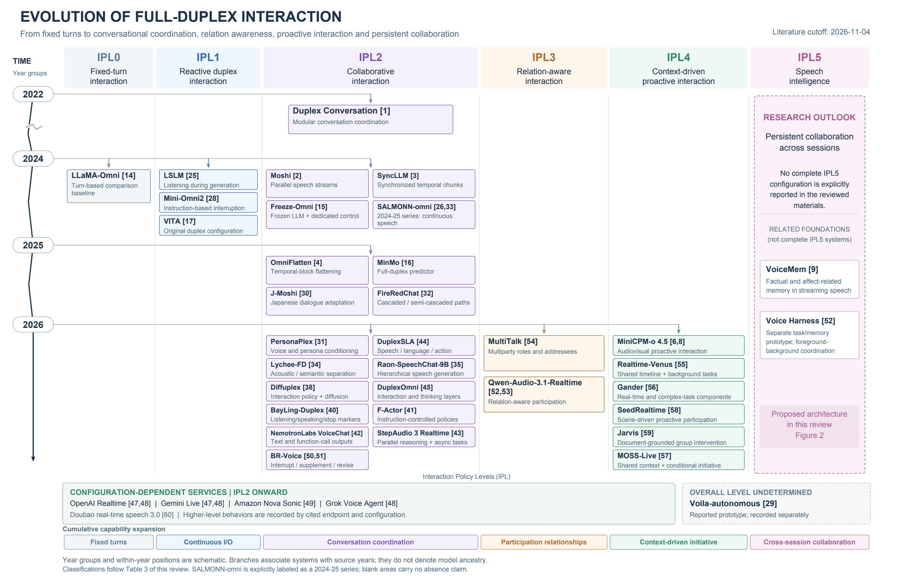
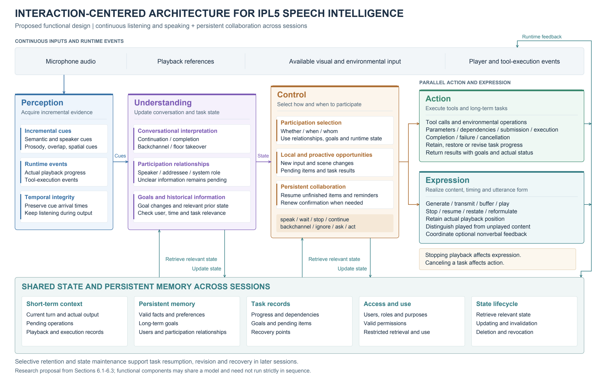

# Speech Intelligence Survey

**Toward Speech Intelligence Centered on Interaction Decisions: A Survey of Full-Duplex Speech Systems**

Chuandong Xie, Mingling Jiang, Huan Shen, Shangkun Huang, Junchao Hu, PengHua Ge, Wei Zou, and Yunzhang Chen.

Research materials for a focused narrative review of full-duplex speech systems, Interaction Policy Levels (IPL), Interaction Policy Dimensions (IPD), evaluation resources, and a proposed architecture for speech intelligence.

[Paper PDF](paper/Speech_Intelligence_Survey.pdf) · [Figures](figures/) · [Synthetic microset](datasets/ffc_bench_microset_v0.3/) · [中文说明](README.zh-CN.md)

## Paper and figures

The English manuscript has 29 pages, 2 figures, and 5 tables. It is the version included in this repository; an arXiv identifier or venue acceptance is not asserted here.

- [Figure 1: evolution of full-duplex interaction (PDF)](figures/figure1_evolution.pdf)
- [Figure 2: proposed IPL5 architecture (PDF)](figures/figure2_architecture.pdf)

## Synthetic materials for future validation

The [FFC-Bench Doubao-Informed Controlled Microset v0.3](datasets/ffc_bench_microset_v0.3/) contains **32 Mandarin semantic templates and 96 synthetic audio renderings**: 32 each under `clean`, `moderate`, and `hard` conditions. Audio is mono, 16 kHz, 16-bit PCM WAV, totaling 483.276 seconds.

These materials are supplied for possible future experimental validation. The current survey does not report a system evaluation on this microset. No system benchmark scores or leaderboard are published in this repository.

The independent semantic unit is a template. Report **N=32 templates / 96 renderings**, with acoustic variants treated as repeated measurements. Reference actions are designer-specified targets and have not undergone independent human annotation.

The recordings were synthesized locally with **Microsoft Huihui Desktop**, using scenario motifs informed by a ByteDance Seed article. The recordings were not supplied by ByteDance or Doubao, and those organizations do not endorse this release.

See the [dataset card](datasets/ffc_bench_microset_v0.3/docs/DATASET_CARD.md), [source and provenance](datasets/ffc_bench_microset_v0.3/docs/SOURCE_AND_PROVENANCE.md), [evaluation protocol](datasets/ffc_bench_microset_v0.3/docs/UNIFIED_EVALUATION_PROTOCOL.md), and [validation status](docs/VALIDATION_STATUS.md).

## Contents

| Directory | Contents |
|---|---|
| `paper/` | Current English manuscript PDF |
| `figures/` | The two figures as PDF and PNG |
| `datasets/ffc_bench_microset_v0.3/audio/mixed/` | 96 synthetic WAV files |
| `datasets/ffc_bench_microset_v0.3/data/` | Original scenario catalog, specification manifest, rendered manifest, and summaries |
| `datasets/ffc_bench_microset_v0.3/metadata/` | Audio inventory, renderer records, and QA/provenance records |
| `docs/` | Material index and validation status |

LaTeX sources, editable SVG originals, generation/scoring scripts, credentials, internal reviews, and working drafts are excluded from this materials release.

## Integrity and provenance

All 96 WAV files and the original CSV/JSON data are preserved byte for byte from the supplied candidate package. Paper and figure PDFs are preserved byte for byte from the latest English manuscript package. Documentation was adapted to this repository and the current manuscript title; the dataset's original creator list is retained in its citation file.

SHA-256 checksums are provided in [SHA256SUMS](SHA256SUMS) and in the dataset directory. File integrity and signal-format QA do not establish perceptual quality, label validity, or model performance.

## Rights and citation

The repository owner authorized publication and confirmed that all 96 synthetic WAV files may be publicly redistributed on 2026-11-13. This repository does not grant an additional blanket reuse license. See [rights and reuse](RIGHTS_AND_REUSE.md) and the [dataset license status](datasets/ffc_bench_microset_v0.3/LICENSE_STATUS.md).

Use [CITATION.cff](CITATION.cff) for the survey and [the dataset citation](datasets/ffc_bench_microset_v0.3/CITATION.cff) when using the microset. No publication DOI is assigned by this repository.
